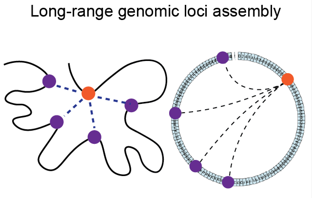
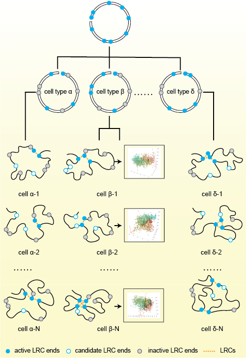

# Long-range Colocalizaiton (LRC) Notebooks
**Long-range genomic loci stochastically assemble into combinatorial forms of chromosome skeleton** 
[Link ](https://doi.org/10.1101/2025.02.10.637328)

## Highlights
1. The spatial proximity of two well-separated cis-loci (>100 Mb) is a prevalent and conserved feature of human chromosomes.
2. While most long-range localizations (LRCs) are formed transiently and present infrequently in tested chromosome copies, ~5% of them recur in 0.8% to >10% subpopulations of entire chromosomes, and are thus considered stable contacts.
3. Multivalent binding is one of the possible mechanisms that ensures a stable LRC structure.
4. A subset of genomic sites serves as nucleation centers (NCs) for clustering stable LRCs, assembling hub-like domains that may be associated with chromosome conformation and territory segregation.
5. These findings suggest a redundant, distributed component mechanism that facilitates chromosome folding into compact structures.

## Hardware requirements
All codes requires a standard computer.

## Software requirements
R version 4.4.1

## OS requirements
These codes were supported for macOS, Linux, and Windows. The codes have been tested on the following systems:

macOS: Sonoma 14.5

Installing R version 4.4.1 on MacOS.

## R Dependencies
User should install the following packages prior to run the codes, from an R terminal:
> *circlize, dplyr, ggExtra, ggplot2, igraph, htmlwidgets, pheatmap, plotly, viridis*

## Expected output
The codes are used to generate figures and results in 
*Long-range genomic loci stochastically assemble into combinatorial forms of chromosome skeleton*

## Reproduction instructions
For codes to generate figures and results in Fig1 and FigS1-5, please download the Hi-C data as described in Table S1.  
For codes to generate figures and results in Fig2-Fig5 and extended Fig6-9, please download:
- **MERFISH chromatin tracing** (Su et al. 2020, Cell): https://zenodo.org/records/3928890
- **DNA seqFISH+** (Takei et al.): https://zenodo.org/records/7693825
- **CHARM** (Chen et al. 2026, Nature): GEO sample GSM9115533, BioProject PRJNA1284811
- **Micro-C** (Palikyras et al. 2024, Aging Cell): GEO sample GSM7661135
